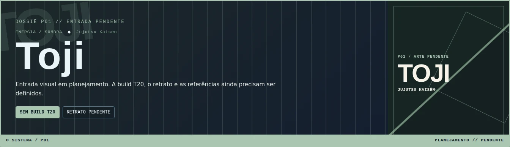
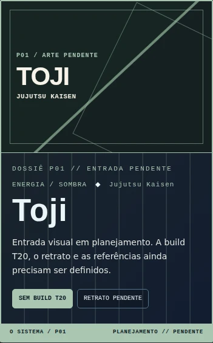
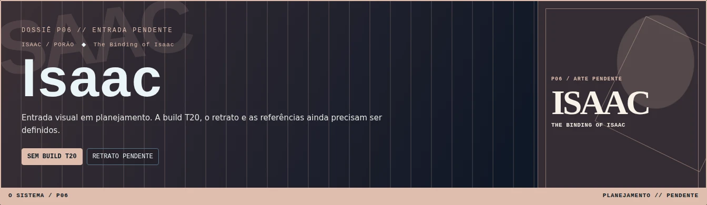
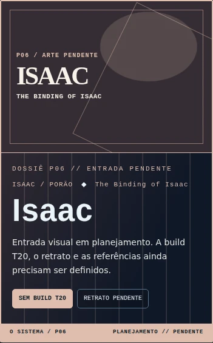

# Expansão solicitada — dez dossiês pendentes

Estas entradas organizam os dez nomes solicitados em 19/11/2026. Elas **não são builds T20 jogáveis**. A obra indicada serve apenas à busca e à identidade visual; não foi usada como fonte de regra. Nenhum retrato canônico foi selecionado.

| Dossiê | Obra de origem | Direção do pôster provisório | Estado |
| --- | --- | --- | --- |
| Toji | Jujutsu Kaisen | corte diagonal e verde apagado | Mecânica, retrato e fontes pendentes |
| Aizen | Bleach | reflexo geométrico e azul frio | Mecânica, retrato e fontes pendentes |
| Vegitto | Dragon Ball | anéis deslocados e âmbar | Mecânica, retrato e fontes pendentes |
| Gogeta | Dragon Ball | diagonal e coral | Mecânica, retrato e fontes pendentes |
| Soul of Cinder | Dark Souls III | cinza e marcas de brasa | Mecânica, retrato e fontes pendentes |
| Isaac | The Binding of Isaac | papel e elipse irregular | Mecânica, retrato e fontes pendentes |
| Adão | Shuumatsu no Valkyrie | círculo monumental e marfim | Mecânica, retrato e fontes pendentes |
| Grimm | Black Souls | página escura e tipografia de conto | Mecânica, retrato e fontes pendentes |
| Sekiro | Sekiro: Shadows Die Twice | papel e corte vertical | Mecânica, retrato e fontes pendentes |
| Kaneki | Tokyo Ghoul | divisão entre claro e escuro | Mecânica, retrato e fontes pendentes |

Cada card abre uma URL `#/id/overview`, com nove abas: identidade, atributos, equipamentos, habilidades, progressão, técnicas, fontes, comparação e revisão. Os campos mecânicos mostram **pendente**. A progressão apresenta doze lugares vazios para planejamento, sem afirmar que um poder ou nível de classe já foi escolhido. A comparação informa que ainda não há variantes. A revisão aceita registros por personagem, URLs e páginas verificadas, com exportação/importação do histórico local.

Quando a mesa fornecer uma build com regras conferidas, cadastre seus dados na fonte mecânica versionada, indique os livros e páginas confirmados, escolha um retrato com crédito e só então migre a entrada de `planned-data.js` para as fichas jogáveis. A identidade gráfica já está mapeada em `visual-direction.js`; ela não determina raça, classe ou poderes.

## Evidência visual

[Os dez cards no celular](screenshots/expansion/375-planejados.webp). Duas capas em desktop e celular demonstram o enquadramento sem atribuir aparência canônica:

| Dossiê | Desktop 1440 px | Celular 375 px |
| --- | --- | --- |
| Toji |  |  |
| Isaac |  |  |

[Soul of Cinder no celular](screenshots/expansion/375-soul-of-cinder-planejado.webp) mostra o terceiro tratamento. São capturas reais do [Chromium em 11 viewports](https://github.com/felipegoncales05-pixel/T20-Guia-das-Fichas/actions/runs/44564333471): sintaxe, integridade, busca, filtros, dez rotas pendentes, ausência de estatísticas presumidas, progressão vazia, formulário editorial, imagens das fichas existentes, variantes, movimento reduzido e ausência de corte horizontal passaram. O artefato `responsivo-capturas` contém os PNG originais; estes WebP são conversões de formato para revisão no repositório.

A curadoria e as capturas da passagem anterior estão em [relatorio-fase-ii.md](relatorio-fase-ii.md).
