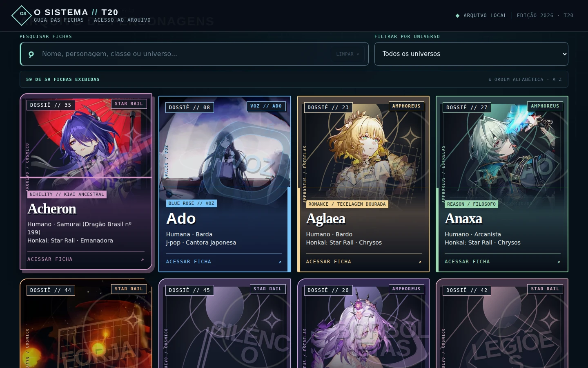
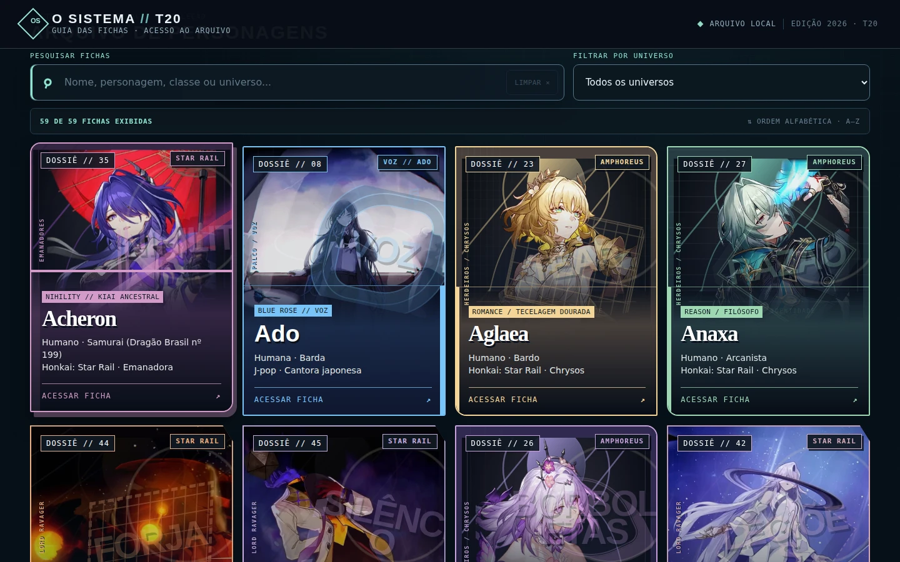
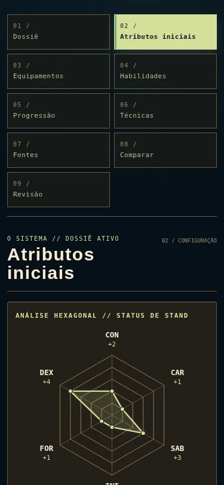
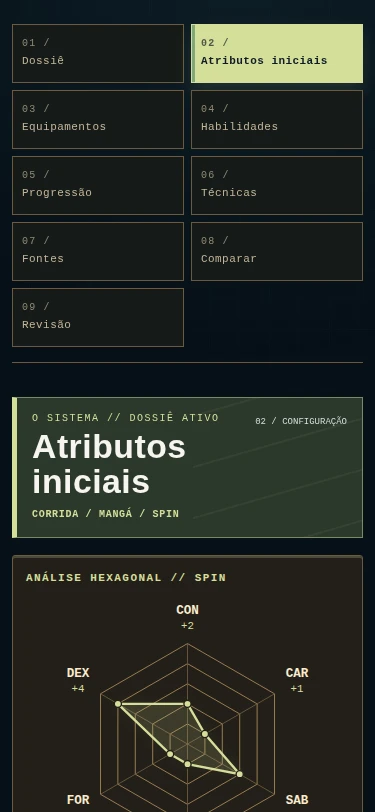

# O Sistema // T20 — relatório da Fase II

Revisão da branch art-direction-overhaul sobre o trabalho visual anterior. A branch principal não foi alterada.

## Cards e dossiês modificados

Os **59 cards** receberam um acabamento material escolhido por personagem e aplicado também às **nove abas** de cada dossiê. Quatro variantes recebem acabamento independente: Diego Alternative e Goku GT, Daima e Super. O inventário completo, com nome, motivo e superfície de cada ficha, está em [Curadoria dos 59 cards](curadoria-fase-ii.md).

O cabeçalho contextual acompanha a capa, atributos, equipamentos, habilidades, progressão, técnicas, fontes, comparação e revisão. A hierarquia preserva os mesmos controles, URLs, imagens, textos e regras. Chrysos, Emanadores e Lord Ravagers passam a ter contornos e linguagens de composição distintos. Diego Alternative e as quatro realidades de Goku mantêm as respectivas identidades nas páginas internas.

## Problemas corrigidos

| Antes | Depois |
| --- | --- |
| O mesmo glifo de mangá ocupava os cards de JoJo; a mesma estrela aparecia em Chrysos, Emanadores e Ravagers. | Motivo individual, textura nas margens do retrato e três tratamentos de grupo diferentes. |
| O radar de atributos dizia “Status de Stand” até para personagens sem Stand. | O subtítulo usa o motivo do personagem. |
| A HUD da Capri colocava um ponto verde independente sobre o rosto. | Os olhos são recortados da própria imagem local e se deslocam no máximo 2 px por 1 px; a boca e “hahaha” surgem juntas. |
| O eco de David cobria áreas grandes do retrato com deslocamentos de até 7 px. | Faixas estreitas, baixa opacidade e deslocamentos de até 2 px; sem tremor do layout. |
| As seções internas repetiam quase a mesma abertura. | Cabeçalho, matéria e bordas contextuais acompanham cada ficha e variante. |

## Exemplos visuais reais

Capturas reais do Chromium a 1440 e 375 px, exportadas em WebP para facilitar a revisão no GitHub. As imagens “antes” pertencem à revisão anterior da mesma branch, registrada nos artefatos de teste antes desta passagem. No celular, o novo cabeçalho e o título do radar mostram a diferença com mais clareza.

| Desktop antes | Desktop depois |
| --- | --- |
|  |  |

| Celular antes | Celular depois |
| --- | --- |
|  |  |

Detalhes para conferir enquadramento: [Capri e David no desktop](screenshots/after/1440-cyberpunk.webp), [Capri e David no celular](screenshots/after/375-cyberpunk.webp), [Diego Alternative](screenshots/after/375-diego-alternative.webp), [Goku GT](screenshots/after/375-goku-gt.webp), [Goku Super](screenshots/after/375-goku-super.webp), [Elster](screenshots/after/375-elster-capa.webp), [Jolyne](screenshots/after/375-jojo-jolyne-capa.webp) e [Acheron](screenshots/after/375-em-acheron-capa.webp).

Os efeitos intermitentes também foram capturados em quadros controlados: [Capri rindo no desktop](screenshots/after/1440-capri-risada.webp) e [no celular](screenshots/after/375-capri-risada.webp); [pulso de David no desktop](screenshots/after/1440-cyberpunk-pulso.webp) e [no celular](screenshots/after/375-cyberpunk-pulso.webp). Esses quadros mostram a expressão, a fala e a faixa de glitch no momento em que aparecem.

## Verificações

- Sintaxe JavaScript, integridade das 59 fichas, 63 assinaturas, imagens locais, busca, navegação de nove abas por ficha, variantes e URLs compartilháveis: aprovadas por testes Node.
- Chromium em 11 viewports de 320 a 1440 px, mais orientação horizontal de 844 × 390 px: sem corte horizontal; imagens locais, variantes, legibilidade das abas, pulso de David e expressão sincronizada da Capri validados. Movimento reduzido desliga as animações e o acompanhamento dos olhos.
- Evidência reproduzível: [execução do GitHub Actions da revisão final](https://github.com/felipegoncales05-pixel/T20-Guia-das-Fichas/actions/runs/44560845923), com artefato `responsivo-capturas` contendo 35 imagens PNG originais. O subconjunto selecionado acima foi convertido em WebP sem redesenhar as capturas.
- Dados de Tormenta20 e imagens aprovadas: nenhum arquivo mecânico ou retrato foi modificado nesta fase.

## Pendências

- Diamond, Taravan e Shuhu continuam com retratos simbólicos pendentes, sem aparência canônica presumida.
- Conferência de regras, páginas de suplementos, créditos em aberto e aprovações da mesa continuam no painel editorial. A revisão visual não aprova fichas automaticamente.
- A revisão permanece em PR de rascunho; não houve publicação nem mescla na branch principal.
